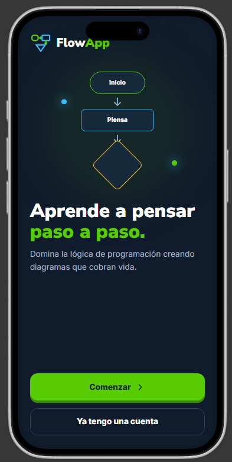
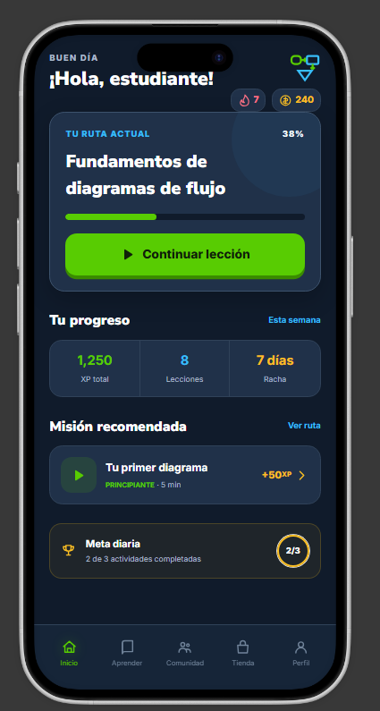
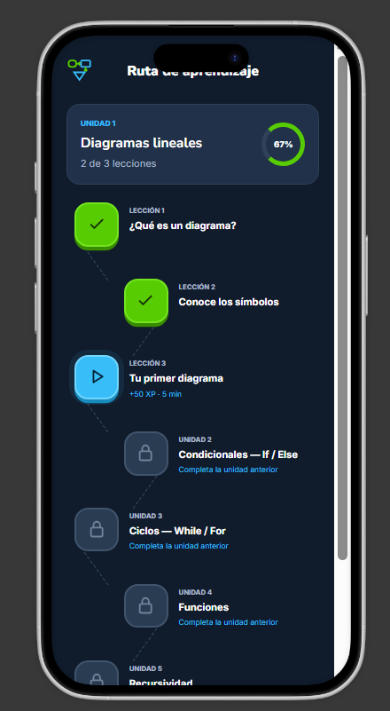
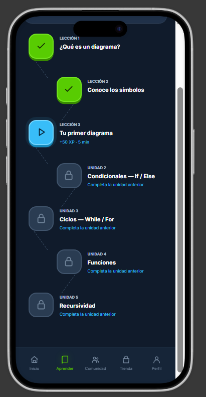
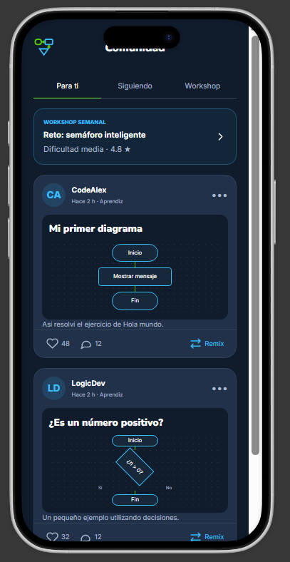
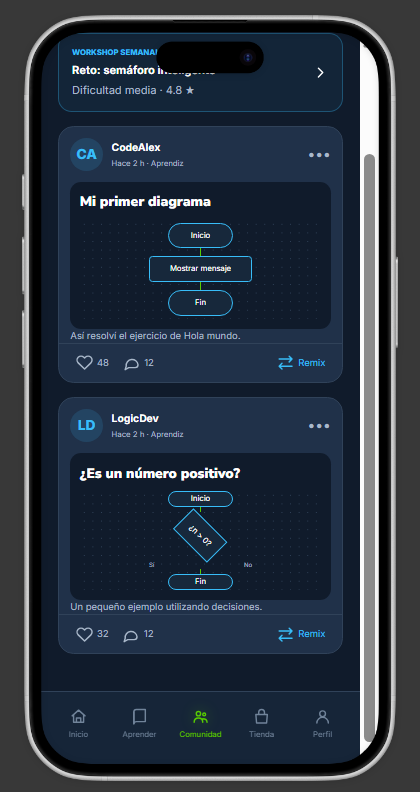
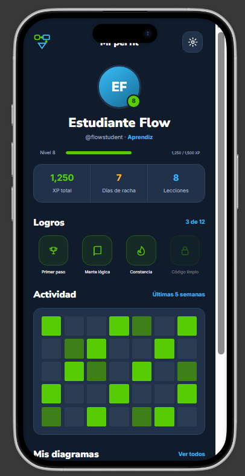
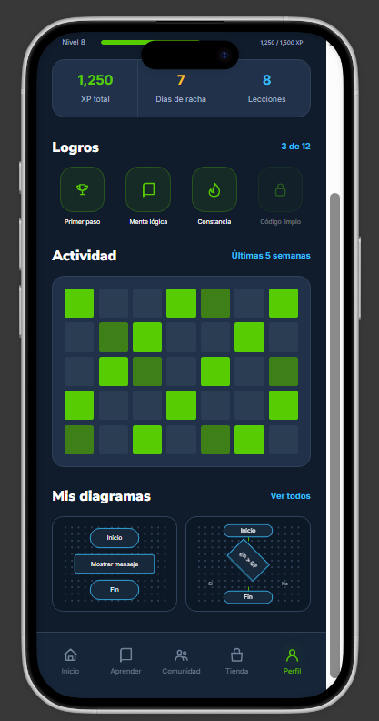
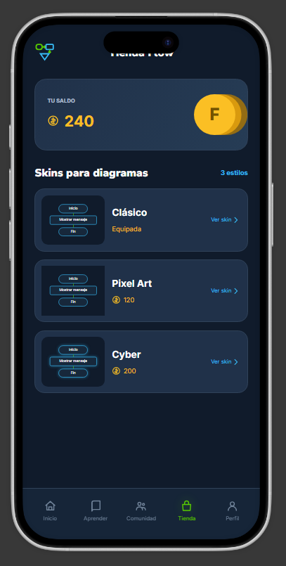

# FlowApp

> Aprende a pensar paso a paso.

**Estado:** En desarrollo · **Stack:** Flutter + Dart

## Descripción

FlowApp es una aplicación diseñada para ayudar a estudiantes de programación a mejorar el desarrollo del pensamiento lógico y crítico, así como la lógica de programación para la resolución de problemas en entornos reales.

También impulsa el desarrollo de habilidades técnicas para el desarrollo de software, conociendo desde las bases de los diagramas de flujo hasta el primer acercamiento a los fundamentos de programación. La experiencia se complementa con módulos sociales y de logros personales, haciendo del aprendizaje una travesía compartida: alcanzar metas propias y competir con una comunidad activa en continuo aprendizaje.

## Alcances

### Aprendizaje

- **Árbol de habilidades:** los usuarios avanzan por un mapa de niveles. Comienzan con diagramas lineales, luego condicionales (`if/else`), ciclos (`while/for`), funciones y recursividad.
- **Mecánica de juego:** en lugar de escribir código, el usuario se enfrenta a un lienzo. El reto consiste en arrastrar y soltar bloques lógicos para resolver un problema.

### Progreso y competencia

- **Rachas y ligas:** mantener la racha diaria resolviendo al menos un diagrama corto. Ligas semanales basadas en la cantidad de problemas lógicos resueltos sin errores.
- **Logros y emblemas técnicos:** logros específicos, por ejemplo "Código Limpio" (resolver el puzzle X usando el mínimo de bloques posibles).

### Comunidad

- **Feed de "Ejecuciones" (Reels/Stories):** cuando un usuario resuelve un diagrama de forma elegante o creativa, puede publicarlo en su feed. La publicación no es una imagen estática, sino una animación visual que muestra cómo viaja el flujo de datos a través de los nodos hasta llegar al resultado.
- **Mecánica de "Fork" (Compartir/Remix):** si un usuario ve un diagrama interesante en el feed de otro, puede darle "Like", comentar o hacer un Fork para llevarlo a su propio editor e intentar optimizarlo usando menos bloques.
- **Workshop (contenido generado por usuarios):** al alcanzar cierto nivel, los usuarios desbloquean el "Creador de Niveles". Pueden diseñar sus propios problemas lógicos, establecer las reglas de validación y publicarlos en la tienda.
- **Reseñas:** los niveles de la comunidad cuentan con un sistema de reseñas estilo Steam. Los mejores puzzles aparecen en la página principal.

### Perfil y personalización

- **Perfiles estéticos:** el perfil muestra el rango, los diagramas más populares y un "Heatmap" de actividad, similar a GitHub pero con una interfaz visual de red social.
- **Inventario y customización:** al completar retos o subir de nivel, los usuarios ganan una moneda virtual. Esta moneda se usa para comprar "Skins" para sus diagramas de flujo (nodos estilo Cyberpunk, Pixel Art o temas oscuros), que luego lucirán en sus publicaciones del feed.

## Bocetos de la aplicación

La carpeta [`/docs`](docs/) contiene todos los bocetos de alta fidelidad de la aplicación. Cada imagen representa una pantalla o flujo del producto.

| Pantalla | Boceto | Descripción |
| --- | --- | --- |
| Onboarding |  | Pantalla de bienvenida con el logo, una muestra de diagrama de flujo y los accesos para comenzar o iniciar sesión. |
| Inicio |  | Dashboard con saludo, racha, monedas, ruta actual, progreso semanal, misión recomendada y meta diaria. |
| Aprender |  | Ruta de aprendizaje por unidades: diagramas lineales, condicionales, ciclos, funciones y recursividad. |
| Aprender (detalle) |  | Vista extendida de la ruta con lecciones completadas, lección actual y unidades bloqueadas. |
| Comunidad |  | Feed con pestañas "Para ti", "Siguiendo" y "Workshop", reto semanal y publicaciones con diagramas. |
| Comunidad (detalle) |  | Vista completa del feed con likes, comentarios y acción de Remix sobre los diagramas publicados. |
| Perfil |  | Perfil con nivel, estadísticas, logros desbloqueados, heatmap de actividad y diagramas propios. |
| Perfil (detalle) |  | Vista extendida del perfil con la sección de logros, actividad y "Mis diagramas". |
| Tienda |  | Tienda con saldo de monedas y skins disponibles: Clásico, Pixel Art y Cyber. |

## Módulos implementados

Actualmente el repositorio se encuentra en su fase inicial. El código existente corresponde a la plantilla base de Flutter.

| Módulo | Estado | Notas |
| --- | --- | --- |
| Proyecto Flutter multiplataforma | Implementado | Soporte para Android, iOS, Web, Windows, macOS y Linux. |
| Estructura base de la aplicación | Implementado | `lib/main.dart` con la aplicación y pantalla de ejemplo generada por Flutter. |
| Pantalla de ejemplo (contador) | Implementado | Plantilla por defecto; será reemplazada por las pantallas reales. |
| Módulos funcionales de FlowApp | Pendiente | Ninguna pantalla o funcionalidad del producto está implementada todavía. |

> **Nota:** las pantallas de la carpeta [`/docs`](docs/) son diseños y bocetos de referencia, no funcionalidades implementadas.

## Pendientes por hacer

### Diseño y documentación

- [x] Definir la identidad visual de la aplicación.
- [x] Documentar los bocetos de las pantallas en `/docs`.
- [x] Crear la estructura base del proyecto Flutter.
- [ ] Validar los bocetos con usuarios y ajustar el diseño.

### Autenticación y onboarding

- [ ] Implementar la pantalla de bienvenida.
- [ ] Implementar el registro de usuarios.
- [ ] Implementar el inicio y cierre de sesión.
- [ ] Implementar la recuperación de contraseña.

### Navegación y pantallas principales

- [ ] Configurar la navegación principal con barra inferior.
- [ ] Implementar la pantalla de Inicio.
- [ ] Implementar la pantalla de Aprender.
- [ ] Implementar la pantalla de Comunidad.
- [ ] Implementar la pantalla de Tienda.
- [ ] Implementar la pantalla de Perfil.

### Ruta de aprendizaje

- [ ] Modelar unidades, lecciones y niveles.
- [ ] Implementar el mapa de progreso y el desbloqueo de unidades.
- [ ] Implementar el sistema de XP.
- [ ] Implementar rachas diarias.
- [ ] Implementar ligas semanales.
- [ ] Implementar logros y emblemas.

### Editor y motor de diagramas

- [ ] Implementar el lienzo de arrastrar y soltar bloques.
- [ ] Implementar los bloques lógicos básicos: inicio, proceso, decisión, entrada/salida y fin.
- [ ] Implementar el motor de ejecución y validación de diagramas.
- [ ] Implementar la animación del flujo de datos.
- [ ] Implementar la optimización por cantidad mínima de bloques.

### Comunidad

- [ ] Implementar el feed de ejecuciones.
- [ ] Implementar likes y comentarios.
- [ ] Implementar la acción de Remix/Fork.
- [ ] Implementar el Workshop y el creador de niveles.
- [ ] Implementar el sistema de reseñas de niveles.
- [ ] Implementar los perfiles públicos y el heatmap de actividad.

### Tienda e inventario

- [ ] Implementar el saldo de moneda virtual.
- [ ] Implementar la compra y equipamiento de skins.
- [ ] Implementar los estilos Clásico, Pixel Art y Cyber.
- [ ] Implementar el inventario de objetos del usuario.

### Infraestructura

- [ ] Definir e implementar el backend y la API.
- [ ] Implementar la persistencia de datos.
- [ ] Implementar pruebas unitarias y de widgets.
- [ ] Configurar integración continua y despliegue.

## Stack y estructura

- **Framework:** Flutter
- **Lenguaje:** Dart
- **Pruebas:** `flutter_test`

```text
flow_app/
├── docs/          # Bocetos de las pantallas
├── lib/
│   └── main.dart  # Punto de entrada de la aplicación
├── test/          # Pruebas
├── android/       # Proyecto Android
├── ios/           # Proyecto iOS
├── web/           # Proyecto Web
├── windows/       # Proyecto Windows
├── macos/         # Proyecto macOS
├── linux/         # Proyecto Linux
├── pubspec.yaml   # Dependencias y configuración
└── README.md
```

### Ejecución

```bash
flutter pub get
flutter run
```

### Pruebas

```bash
flutter test
```

## Estado del proyecto

FlowApp se encuentra en fase de diseño y estructuración. Los bocetos de la experiencia están definidos en [`/docs`](docs/), mientras que la implementación de los módulos funcionales está pendiente.
