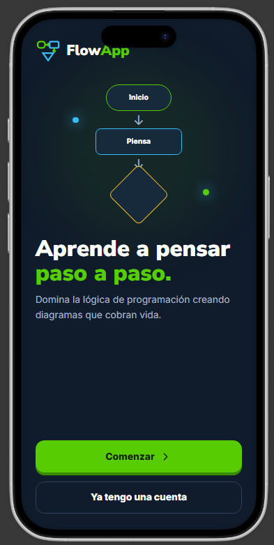
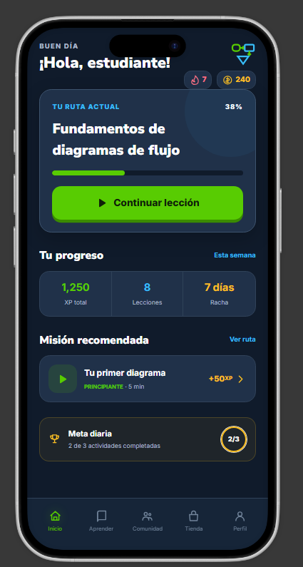
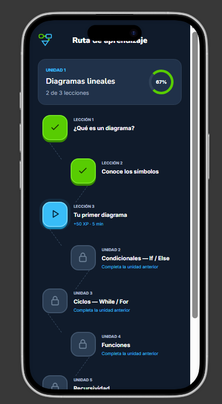
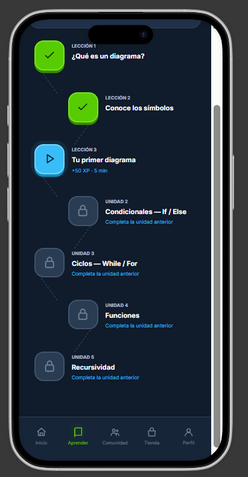
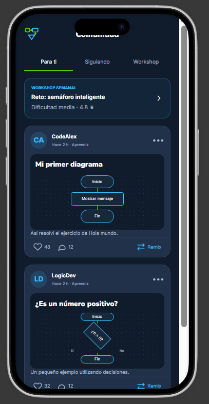
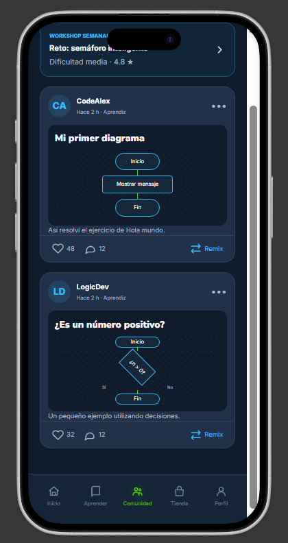
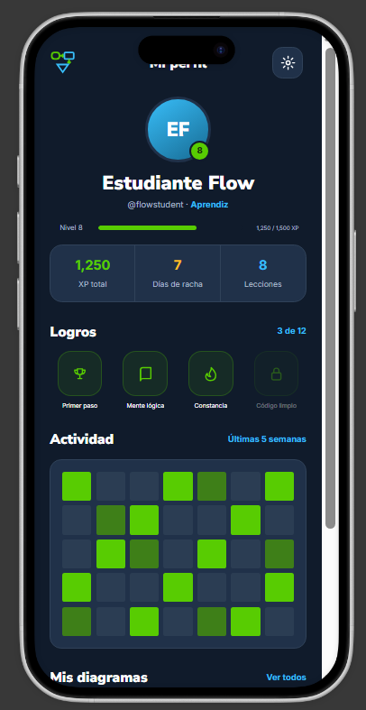
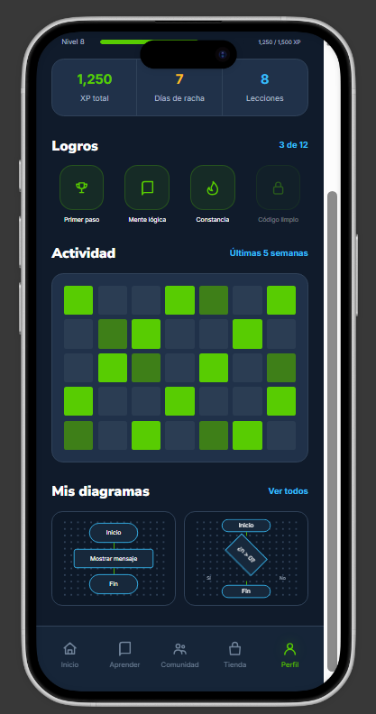
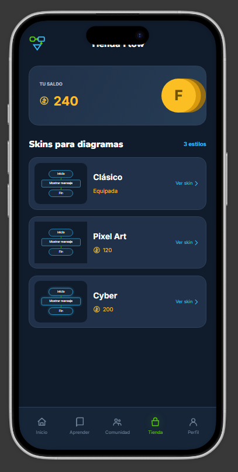

# FlowApp

> Aprende a pensar paso a paso.

**Estado:** En desarrollo · **Stack:** Flutter + Dart + Supabase · **Última etapa:** Tienda e inventario conectados a Supabase (monedas, skins, títulos, plantillas y consumibles)

## Descripción

FlowApp es una aplicación diseñada para ayudar a estudiantes de programación a mejorar el desarrollo del pensamiento lógico y crítico, así como la lógica de programación para la resolución de problemas en entornos reales.

También impulsa el desarrollo de habilidades técnicas para el desarrollo de software, conociendo desde las bases de los diagramas de flujo hasta el primer acercamiento a los fundamentos de programación. La experiencia se complementa con módulos sociales y de logros personales, haciendo del aprendizaje una travesía compartida: alcanzar metas propias y competir con una comunidad activa en continuo aprendizaje.

## Alcances

### Aprendizaje

- **Árbol de habilidades:** los usuarios avanzan por un mapa de niveles. Comienzan con diagramas lineales, luego condicionales (`if/else`), ciclos (`while/for`), funciones y recursividad.
- **Mecánica de juego:** en lugar de escribir código, el usuario se enfrenta a un lienzo. El reto consiste en arrastrar y soltar bloques lógicos para resolver un problema.

### Progreso y competencia

- **Rachas y ligas:** mantener la racha diaria resolviendo al menos un diagrama corto. Ligas semanales basadas en la cantidad de problemas lógicos resueltos sin errores.
- **Logros y emblemas técnicos:** logros específicos, por ejemplo "Código Limpio" (resolver el puzzle X usando el mínimo de bloques posibles).

### Comunidad

- **Feed de "Ejecuciones" (Reels/Stories):** cuando un usuario resuelve un diagrama de forma elegante o creativa, puede publicarlo en su feed. La publicación no es una imagen estática, sino una animación visual que muestra cómo viaja el flujo de datos a través de los nodos hasta llegar al resultado.
- **Mecánica de "Fork" (Compartir/Remix):** si un usuario ve un diagrama interesante en el feed de otro, puede darle "Like", comentar o hacer un Fork para llevarlo a su propio editor e intentar optimizarlo usando menos bloques.
- **Workshop (contenido generado por usuarios):** al alcanzar cierto nivel, los usuarios desbloquean el "Creador de Niveles". Pueden diseñar sus propios problemas lógicos, establecer las reglas de validación y publicarlos en la tienda.
- **Reseñas:** los niveles de la comunidad cuentan con un sistema de reseñas estilo Steam. Los mejores puzzles aparecen en la página principal.

### Perfil y personalización

- **Perfiles estéticos:** el perfil muestra el rango, los diagramas más populares y un "Heatmap" de actividad, similar a GitHub pero con una interfaz visual de red social.
- **Inventario y customización:** al completar retos o subir de nivel, los usuarios ganan una moneda virtual. Esta moneda se usa para comprar "Skins" para sus diagramas de flujo (nodos estilo Cyberpunk, Pixel Art o temas oscuros), que luego lucirán en sus publicaciones del feed.

## Bocetos de la aplicación

La carpeta [`/docs`](docs/) contiene todos los bocetos de alta fidelidad de la aplicación. Cada imagen representa una pantalla o flujo del producto.

| Pantalla | Boceto | Descripción | Estado |
| --- | --- | --- | --- |
| Onboarding |  | Pantalla de bienvenida con el logo, una muestra de diagrama de flujo y los accesos para comenzar o iniciar sesión. | **Mock estático** |
| Inicio |  | Dashboard con saludo, racha, monedas, ruta actual, progreso semanal, misión recomendada y meta diaria. | **Mock estático** |
| Aprender |  | Ruta de aprendizaje por unidades: diagramas lineales, condicionales, ciclos, funciones y recursividad. | **Mock estático** |
| Aprender (detalle) |  | Vista extendida de la ruta con lecciones completadas, lección actual y unidades bloqueadas. | **Mock estático** |
| Comunidad |  | Feed con pestañas "Para ti", "Siguiendo" y "Workshop", reto semanal y publicaciones con diagramas. | **Mock estático** |
| Comunidad (detalle) |  | Vista completa del feed con likes, comentarios y acción de Remix sobre los diagramas publicados. | **Mock estático** |
| Perfil |  | Perfil con nivel, estadísticas, logros desbloqueados, heatmap de actividad y diagramas propios. | **Implementado (Supabase)** |
| Perfil (detalle) |  | Vista extendida del perfil con la sección de logros, actividad y "Mis diagramas". | **Implementado (Supabase)** |
| Tienda |  | Tienda con saldo real, cofre diario, skins para diagramas, títulos de perfil, plantillas y consumibles. | **Implementado (Supabase)** |

## Módulos implementados

El repositorio ya cuenta con la estructura base de la aplicación, el tema visual, la autenticación real con Supabase, el perfil persistido en base de datos y las demás pantallas del producto construidas como mocks estáticos.

| Módulo | Estado | Notas |
| --- | --- | --- |
| Proyecto Flutter multiplataforma | Implementado | Soporte para Android, iOS, Web, Windows, macOS y Linux. |
| Tema visual base | Implementado | Paleta extraída de los bocetos de [`/docs`](docs/) y estilos de texto centralizados. |
| Shell de navegación | Implementado (mock) | Barra inferior con las pestañas Inicio, Aprender, Comunidad, Tienda y Perfil; todas muestran su pantalla correspondiente. |
| Autenticación (Supabase) | Implementado | Registro e inicio de sesión con email y contraseña, cierre de sesión, sesión persistente y mensajes de error en español. El acceso a la app requiere sesión. |
| Pantalla Bienvenida | Implementado (mock) | Logo, diagrama decorativo, titular, accesos “Comenzar” (registro) y “Ya tengo una cuenta” (login), y feedback para el cambio de tema. |
| Pantalla Inicio | Implementado (mock) | Saludo, racha, monedas, ruta actual, progreso semanal, misión recomendada y meta diaria con datos estáticos. |
| Pantalla Aprender | Implementado (mock) | Resumen de unidad, progreso y ruta con lecciones completadas, actuales y unidades bloqueadas. La lección 3 es interactiva: permite armar un diagrama lineal de tres bloques y actualiza el progreso en memoria. |
| Pantalla Comunidad | Implementado (mock) | Feed con pestañas, reto semanal, publicaciones con diagramas, likes locales y feedback para comentarios, Remix y menú de publicación. |
| Pantalla Tienda | Implementado (Supabase) | Saldo de monedas, cofre diario, catálogo por categorías, compra, equipamiento, plantillas y consumibles. |
| Pantalla Perfil | Implementado (Supabase) | Perfil cargado desde Postgres: nombre, usuario, rol, XP, nivel, racha, lecciones, logros, heatmap de actividad y diagramas. Permite editar nombre/usuario y subir una foto a Supabase Storage. |
| Base de datos del perfil y tienda | Implementado | Tablas `profiles`, `achievements`, `user_achievements`, `diagrams`, `daily_activity`, `store_items`, `user_inventory`, `store_purchases`, `lesson_rewards` y `lesson_completions`, con RLS, triggers y bucket `avatars`. Incluye migraciones y seed de demostración en [`/supabase`](supabase/). |
| Módulos funcionales de FlowApp | Parcial | Autenticación, perfil y tienda ya usan Supabase; el progreso de las lecciones y la comunidad siguen con datos mock. |

> **Nota:** las pantallas de la carpeta [`/docs`](docs/) son diseños y bocetos de referencia. La autenticación, el perfil y la tienda ya están conectados a Supabase; Inicio, Aprender y Comunidad replican sus bocetos con datos estáticos y la lógica de negocio del progreso sigue pendiente.

### Detalle de la implementación actual

- **Tema:** colores y estilos centralizados en [`lib/core/theme/`](lib/core/theme/), con paleta oscura, verde neón y azul cian extraídos de los bocetos.
- **Autenticación:** capa en [`lib/core/auth/`](lib/core/auth/) con una interfaz `AuthRepository`, la implementación `SupabaseAuthRepository` y `AuthGate`, que decide entre Bienvenida y el shell según la sesión. Las pantallas de login y registro viven en [`lib/features/auth/`](lib/features/auth/) con validaciones, estados de carga y errores traducidos al español.
- **Bienvenida:** pantalla inicial en [`lib/features/welcome/`](lib/features/welcome/) con el diagrama decorativo y el feedback para el cambio de tema. “Comenzar” abre el registro y “Ya tengo una cuenta” abre el login.
- **Inicio:** composición responsive en [`lib/features/home/home_screen.dart`](lib/features/home/home_screen.dart), con ancho máximo de 480 px en pantallas grandes y desplazamiento vertical en pantallas pequeñas.
- **Widgets compartidos:** fondo, logo, wordmark, encabezados de sección, tarjetas de estadísticas y previsualización de diagramas en [`lib/shared/`](lib/shared/).
- **Aprender:** resumen de unidad y ruta de lecciones en [`lib/features/learn/`](lib/features/learn/), con conectores y estados de lección completada, actual y bloqueada. La lección 3 abre una pantalla interactiva que valida el orden **Inicio → Mostrar mensaje → Fin**; al aprobarla suma +50 XP y marca la unidad al 100% en memoria. Los datos de la lección viven en [`models/diagram_lesson.dart`](lib/features/learn/models/diagram_lesson.dart), listos para sustituirse por una fuente con base de datos.
- **Comunidad:** feed en [`lib/features/community/community_screen.dart`](lib/features/community/community_screen.dart), con datos mock por pestaña, banner de workshop, publicaciones y previsualizaciones de diagramas en [`lib/features/community/widgets/`](lib/features/community/widgets/). Los likes se actualizan localmente y las acciones pendientes muestran un `SnackBar`.
- **Tienda:** catálogo real en [`lib/features/store/`](lib/features/store/) con skins, títulos, plantillas y consumibles. El saldo, el cofre diario, las compras y el equipamiento se persisten en Supabase mediante RPC atómicas. La skin y el título equipados se reflejan en el perfil; las plantillas compradas se añaden a “Mis diagramas”; el boost de XP duplica la recompensa de las lecciones.
- **Perfil:** datos reales desde Supabase en [`lib/features/profile/`](lib/features/profile/): nombre, usuario, rol, avatar, XP, nivel, racha, lecciones, logros, heatmap de actividad (7 días × 5 semanas) y diagramas propios. Permite editar nombre y usuario desde un bottom sheet, subir la foto a Storage y abrir la galería completa en [`my_diagrams_screen.dart`](lib/features/profile/my_diagrams_screen.dart). Incluye estados de carga, error con reintento, pull-to-refresh y estados vacíos.
- **Persistencia del perfil:** capa de datos en [`lib/features/profile/repositories/`](lib/features/profile/repositories/) con `ProfileRepository`, `SupabaseProfileRepository`, modelos en [`models/profile_models.dart`](lib/features/profile/models/profile_models.dart) y utilidades del heatmap en [`utils/activity_weeks.dart`](lib/features/profile/utils/activity_weeks.dart). El esquema SQL, las políticas RLS y el bucket de avatares están en [`supabase/migrations/`](supabase/migrations/); el seed opcional con los datos del boceto está en [`supabase/seed_demo.sql`](supabase/seed_demo.sql).
- **Persistencia de la tienda:** catálogo e inventario en [`lib/features/store/repositories/`](lib/features/store/repositories/) con `StoreRepository` y `SupabaseStoreRepository`, modelos en [`models/store_models.dart`](lib/features/store/models/store_models.dart) y un `WalletController` compartido para el saldo. La migración [`20261102000200_store.sql`](supabase/migrations/20261102000200_store.sql) crea el catálogo, el inventario, las compras, las recompensas de lecciones, los RPC y las políticas RLS.
- **Navegación:** `AuthGate` es la raíz de la app; sin sesión muestra Bienvenida y con sesión muestra el shell con `IndexedStack`. La barra inferior de cinco pestañas está en [`lib/core/navigation/app_shell.dart`](lib/core/navigation/app_shell.dart) y [`lib/shared/widgets/flow_bottom_nav.dart`](lib/shared/widgets/flow_bottom_nav.dart).
- **Datos:** el perfil, la sesión y la tienda se gestionan con Supabase. Inicio, Aprender y Comunidad (`7`, `38%`, `1,250 XP`, `2/3`, `48 likes`, etc.) siguen usando constantes locales; el saldo de monedas de Inicio ya se sincroniza con el `WalletController`.
- **Dependencias:** se usa Flutter, `supabase_flutter` para autenticación, Postgres y Storage, `flutter_dotenv` para leer las claves desde `.env`, `flutter_test` e `image_picker` para seleccionar la foto de perfil desde la galería. En iOS se añadió `NSPhotoLibraryUsageDescription`; en macOS, el permiso de lectura de archivos seleccionados por el usuario y acceso de red saliente.

## Pendientes por hacer

### Diseño y documentación

- [x] Definir la identidad visual de la aplicación.
- [x] Documentar los bocetos de las pantallas en `/docs`.
- [x] Crear la estructura base del proyecto Flutter.
- [ ] Validar los bocetos con usuarios y ajustar el diseño.

### Autenticación y onboarding

- [x] Implementar la pantalla de bienvenida (mock estático).
- [x] Implementar el registro de usuarios.
- [x] Implementar el inicio y cierre de sesión.
- [ ] Implementar la recuperación de contraseña.

### Navegación y pantallas principales

- [x] Configurar la navegación principal con barra inferior.
- [x] Implementar la pantalla de Inicio como mock estático.
- [x] Implementar la pantalla de Aprender (mock estático).
- [x] Implementar la pantalla de Comunidad (mock estático).
- [x] Implementar la pantalla de Tienda conectada a Supabase.
- [x] Implementar la pantalla de Perfil conectada a Supabase.

### Ruta de aprendizaje

- [ ] Modelar unidades, lecciones y niveles.
- [ ] Implementar el mapa de progreso y el desbloqueo de unidades.
- [ ] Implementar el sistema de XP.
- [ ] Implementar rachas diarias.
- [ ] Implementar ligas semanales.
- [ ] Implementar logros y emblemas.

### Editor y motor de diagramas

- [ ] Implementar el lienzo de arrastrar y soltar bloques.
- [ ] Implementar los bloques lógicos básicos: inicio, proceso, decisión, entrada/salida y fin.
- [ ] Implementar el motor de ejecución y validación de diagramas.
- [ ] Implementar la animación del flujo de datos.
- [ ] Implementar la optimización por cantidad mínima de bloques.

### Comunidad

- [x] Implementar el feed de ejecuciones (mock local).
- [x] Implementar likes locales en el feed (sin persistencia).
- [ ] Implementar comentarios y la acción de Remix/Fork.
- [ ] Implementar el Workshop y el creador de niveles.
- [ ] Implementar el sistema de reseñas de niveles.
- [ ] Implementar los perfiles públicos.
- [x] Implementar el heatmap de actividad en el Perfil (datos de Supabase).

### Tienda e inventario

- [x] Implementar el saldo de moneda virtual.
- [x] Implementar la compra y equipamiento de skins.
- [x] Implementar los estilos Clásico, Pixel Art, Cyber, Neón, Bosque y Minimal.
- [x] Implementar el inventario de objetos del usuario.
- [x] Implementar títulos de perfil, plantillas de diagramas y consumibles.
- [x] Implementar recompensas de lección y cofre diario.
- [ ] Implementar la congelación automática de rachas cuando exista la lógica de rachas.

### Infraestructura

- [x] Integrar Supabase para autenticación (email y contraseña).
- [x] Persistir perfil, logros, actividad, diagramas, tienda e inventario en Supabase (con RLS y Storage).
- [ ] Definir e implementar el backend y la API del resto de módulos.
- [ ] Implementar la persistencia del progreso de aprendizaje y la comunidad.
- [x] Implementar pruebas de widgets para Bienvenida, Inicio, Aprender, Comunidad, Tienda y Perfil.
- [x] Implementar pruebas unitarias de la lógica del heatmap.
- [ ] Configurar integración continua y despliegue.

## Stack y estructura

- **Framework:** Flutter
- **Lenguaje:** Dart
- **Autenticación y datos:** Supabase (`supabase_flutter`, Postgres y Storage)
- **Configuración:** `flutter_dotenv` (`.env`)
- **Pruebas:** `flutter_test`

```text
flow_app/
├── docs/          # Bocetos de las pantallas
├── lib/
│   ├── core/
│   │   ├── auth/         # Repositorio de auth, Supabase y AuthGate
│   │   ├── config/       # Lectura de .env y configuración de Supabase
│   │   ├── navigation/   # Shell de navegación
│   │   └── theme/        # Colores y tema
│   ├── features/
│   │   ├── welcome/      # Pantalla de bienvenida y diagrama
│   │   ├── auth/         # Login, registro y widgets de formulario
│   │   ├── home/         # Pantalla Inicio y widgets
│   │   ├── learn/        # Pantalla Aprender y ruta de lecciones
│   │   ├── community/    # Pantalla Comunidad, modelos y widgets
│   │   ├── store/        # Tienda, inventario, monedas y recompensas
│   │   └── profile/      # Perfil, modelos, repositorios, servicios y widgets
│   ├── shared/
│   │   ├── models/       # Modelos compartidos de diagramas
│   │   ├── utils/        # Formateadores compartidos
│   │   └── widgets/      # Fondo, logo, barra inferior y componentes
│   ├── app.dart          # Configuración de la aplicación
│   └── main.dart         # Punto de entrada
├── supabase/
│   ├── migrations/       # Esquema, triggers, RLS y bucket de avatares
│   └── seed_demo.sql     # Datos de demostración opcionales
├── test/          # Pruebas
├── android/       # Proyecto Android
├── ios/           # Proyecto iOS
├── web/           # Proyecto Web
├── windows/       # Proyecto Windows
├── macos/         # Proyecto macOS
├── linux/         # Proyecto Linux
├── pubspec.yaml   # Dependencias y configuración
├── .env.example   # Plantilla de variables de Supabase
└── README.md
```

### Configuración de Supabase

1. Copia `.env.example` a `.env` en la raíz del proyecto y completa las claves del panel de Supabase (Project Settings → API):

   ```text
   SUPABASE_URL=https://tu-proyecto.supabase.co
   SUPABASE_ANON_KEY=tu-clave-publica
   ```

2. En Supabase, ve a **Authentication → Providers → Email** y confirma que el proveedor esté habilitado.
3. Si desactivas **Authentication → Settings → Confirm email**, el registro inicia sesión automáticamente. Si lo dejas activo, la app pedirá confirmar el correo antes de entrar.
4. Usa solo la clave pública (`anon` o `publishable`). Nunca incluyas la clave `service_role` en la aplicación.
5. Ejecuta [`supabase/migrations/20261102000100_profile.sql`](supabase/migrations/20261102000100_profile.sql) en el SQL Editor de Supabase (o con Supabase CLI). Crea las tablas del perfil, los triggers, las políticas RLS y el bucket público `avatars`; también rellena los perfiles de usuarios existentes.
6. Ejecuta [`supabase/migrations/20261102000200_store.sql`](supabase/migrations/20261102000200_store.sql). Añade monedas y equipamiento a `profiles`, crea el catálogo, el inventario, las compras, las recompensas de lecciones y los RPC atómicos de la tienda. Es idempotente.
7. Opcional: edita el correo de [`supabase/seed_demo.sql`](supabase/seed_demo.sql) y ejecútalo para cargar los datos del boceto (1,250 XP, nivel 8, monedas, logros, diagramas y actividad).
8. Verifica en **Storage** que el bucket `avatars` exista y sea público.

El perfil y la tienda usan las tablas `profiles`, `achievements`, `user_achievements`, `diagrams`, `daily_activity`, `store_items`, `user_inventory`, `store_purchases`, `lesson_rewards` y `lesson_completions`. Todas tienen RLS: cada usuario solo puede leer y modificar sus propios datos; el catálogo de logros y de la tienda es de solo lectura. Las monedas y el equipamiento solo se modifican a través de los RPC de la tienda.

`.env` está ignorado por git y no se versiona. Si falta o está incompleto, la app muestra una pantalla con las instrucciones de configuración.

### Ejecución

```bash
flutter pub get
flutter run
```

### Pruebas y análisis

```bash
flutter analyze
flutter test
```

Las pruebas actuales cubren la bienvenida y su navegación (`welcome_screen_test.dart`), el login y el registro con un repositorio falso (`auth_flow_test.dart`), el contenido estático de Inicio, el feed y las pestañas de Comunidad, el like local, el feedback de Remix y de la galería, Aprender, la lección interactiva y su recompensa (`lesson_screen_test.dart`), la tienda con un repositorio falso (`store_screen_test.dart`: carga, compra, saldo insuficiente, equipamiento, plantillas, consumibles, cofre diario, error y reintento), el cierre de sesión y la ausencia de desbordamientos en pantallas pequeñas. El perfil está cubierto con un repositorio falso en `profile_db_test.dart` (carga, error y reintento, edición, usuario duplicado, estados vacíos y galería), la subida de foto en `profile_avatar_test.dart`, y la lógica del heatmap en `activity_weeks_test.dart`. En total son 59 pruebas.

## Estado del proyecto

FlowApp se encuentra en fase de desarrollo. Los bocetos de la experiencia están definidos en [`/docs`](docs/), el tema visual y el shell de navegación están configurados, la autenticación con Supabase (registro, inicio y cierre de sesión con sesión persistente), el perfil (datos, edición, avatar, logros, actividad y diagramas) y la tienda (monedas, compras, inventario, skins, títulos, plantillas, consumibles y cofre diario) ya son funcionales. Inicio, Aprender y Comunidad siguen usando datos mock. Actualmente `flutter analyze` no reporta problemas y las 59 pruebas pasan. La lógica de negocio del progreso, la persistencia del resto de módulos y el backend propio siguen pendientes.
